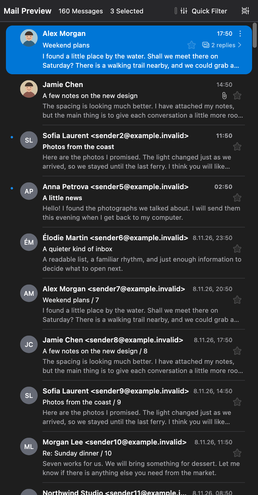
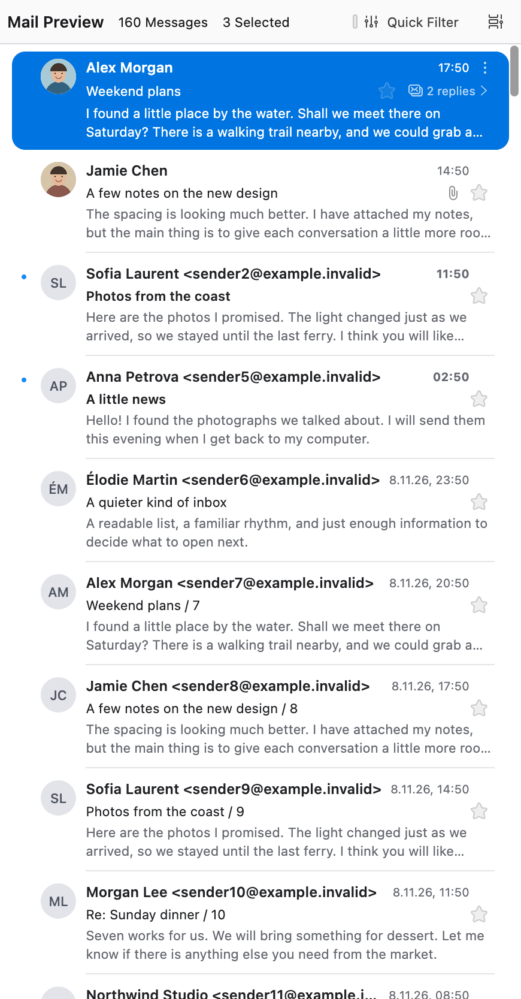

# ThwunderList


Mail.app-style message cards for Thunderbird 159.0+.

- **Compact Cards View** with prominent senders, subjects, dates and one to four
  lines of body text. Row height follows the preview line count and font size.
- **Contact photos and initials** from local address books, with an option to
  hide avatars. Optional remote avatars use Gravatar and DuckDuckGo domain icons,
  without API keys.
- **Native mail controls**: threading, sorting, selection, context menus,
  tags and message actions remain available.
- **Light and dark palettes**, rounded selection and inset separators.
- Table View, the folder sidebar, toolbars and message reader are unchanged.

## Message previews

Visible messages first use Thunderbird's cached excerpts. If no excerpt is
available, the add-on reads the MIME message, decodes the body, converts HTML
to plain text and caches the first 500 characters in the folder database.
Long HTML style blocks and encoded bodies are handled by the MIME fallback
rather than the native 2 KB excerpt limit.

**The fallback can download the complete message, including attachments,
from the configured mail server.** MIME requests run one at a time per mail
tab, only for visible rows still missing a preview. In-flight downloads may
finish after scrolling away. Offline mode uses local bodies and cached excerpts.

## Mail safety

Preview loading does not mark messages read, alter message bodies or load
images from message content. Attachment contents are not used as preview text. Extracted
text is inserted as text, never rendered as HTML.

Avatars prefer Thunderbird's address-book lookup, including secondary email
addresses. Only local photo files and embedded images are accepted from contacts;
remote contact photo URLs are ignored. Sent folders use the first recipient's
photo. Address-book entries are never modified, and contact edits refresh the
list through Thunderbird's own updates.

### Optional remote avatars

**Disabled by default.** Enable **Fetch missing avatars from the internet** in
the add-on settings to try [Gravatar](https://docs.gravatar.com/sdk/images/), then
[DuckDuckGo domain icons](https://icons.duckduckgo.com/ip3/duckduckgo.com.ico) when
a local photo is missing or broken. Unavailable images leave the initials intact.
No account or API key is needed. DuckDuckGo's public icon endpoint is not a
guaranteed API and may change or stop working.

Gravatar receives a SHA-256 hash of the trimmed, lowercased email address.
DuckDuckGo receives the registrable domain (for example, `news.example.co.uk`
becomes `example.co.uk`), not the full email address. Common personal-mail
providers such as Gmail, Outlook and Yahoo are excluded from domain-icon
lookups; this list is not exhaustive. Both services receive your IP address.
**Email hashes are not anonymous.**

Remote avatars appear only for incoming messages that your mail provider
marked as authenticated: the topmost `Authentication-Results` header must show
DMARC pass for the From domain, or DKIM pass aligned with it. Gmail, Outlook,
Fastmail and most filtering servers add this header. Messages without it, and
messages not stored locally (for example IMAP folders not synchronised for
offline use), keep initials. If your server adds no such header, a sender can
forge one, so the check is only as good as your provider. Authentication proves
the domain, not the person: a logo or photo still does not vouch for the content.
Sent messages need no check, because you chose the recipients.

Messages marked as junk, or stored in a Junk folder, are never looked up:
DuckDuckGo may fetch the icon from the sender's own site, which would tell a
sender who controls a rarely seen domain that the message was listed.
Addresses without a public domain suffix, such as `corp.internal`, are never
sent to either service.

Lookups run one at a time per mail tab, only for visible cards while avatars
are shown and Thunderbird is online. Requests omit cookies and referrers,
reject redirects, time out after five seconds per provider, and accept only
raster images up to 128 KiB, between 32×32 and 512×512 pixels. Fetched images are kept for 7 days and misses for 1 day, at most 256 entries, in
`thwunderlist-avatars.json` in the profile's local cache directory, so they
survive restarts; requests themselves bypass Thunderbird's HTTP cache. Hiding
avatars, disabling remote lookups, or disabling, updating or removing the add-on
deletes that file. Going offline aborts pending requests. A request already sent
cannot be undone.
No analytics are used.

## Install

Download the XPI from [Releases](https://github.com/Narmo/ThwunderList/releases),
or build locally with Node.js 22+, Python 3 and `zip`:

```sh
scripts/build.sh            # -> dist/thwunderlist-<version>.xpi
```

Thunderbird → Add-ons and Themes → Extensions → ⚙ → *Install Add-on From File…*.

Select **Cards View** in the message-list display menu.
**View → Layout → Vertical View** gives the closest Mail.app layout.
Saved view, theme, density and pane-layout preferences are left unchanged.

The add-on uses a privileged WebExtension Experiment to modify Thunderbird's
internal UI. Thunderbird therefore requests full access to the application
and computer. The implementation is in `experiments/mail-list/api.js`.

## Settings

- **Show sender avatars** — **View → Show sender avatars**, directly below
  **Display Attachments Inline**, or **ThwunderList → Preferences/Options**
  in the Add-ons Manager. Enabled by default; both controls stay synchronized.
- **Fetch missing avatars from the internet** — opt-in, default off, in the
  add-on settings. Local contact photos always take priority.
- **Preview lines** — 1–4, default 2, in the add-on settings. Row height adjusts
  automatically to the line count and font size.

Settings apply immediately to all mail tabs and persist across restarts.

## Screenshots

Thunderbird 159 with synthetic local messages:

| Dark | Light |
| --- | --- |
|  |  |

## Releases

Branch pushes and pull requests run [CI](.github/workflows/ci.yml): syntax
checks, an XPI build and an uploaded `thwunderlist-xpi` artifact.

Pushing a `v*` tag runs [the release workflow](.github/workflows/release.yml):
it checks the tag matches `manifest.json`, builds the XPI and publishes a
GitHub Release with generated notes. GitHub's built-in token is sufficient;
no extra secrets are needed. Existing releases and their assets are left
unchanged on reruns.

Update `manifest.json` and commit before tagging a new release. For example,
after setting the version to `1.0.1`:

```sh
git tag -a v1.0.1 -m "ThwunderList 1.0.1"
git push origin HEAD v1.0.1
```

The tagged commit must include the workflow and build script. Existing tags
do not trigger releases retroactively. For an existing tag without a release,
use **Actions → Release → Run workflow** on `master` and enter that tag.
The manual run builds the tagged source, not the latest branch.

This does not sign the XPI or publish it to addons.thunderbird.net.

## Tests

The build script checks JavaScript and JSON syntax and packages only runtime
files and license notices. CI runs these checks, not Thunderbird UI tests.

Runtime checks were performed separately in isolated macOS Thunderbird 159
and 160 profiles with synthetic local mail and a local IMAP server. Coverage includes
plain-text and HTML previews, encoded bodies, unread flags, address-book
photos, settings, row sizing, scrolling, multiple tabs/windows and cleanup
on disable or uninstall.

## Limits

- The add-on uses Thunderbird's internal card API, checked on 159 and 160.
  Later versions are allowed by the manifest but may require changes.
- Other platforms, external mail providers and screen-reader output have not
  been tested.
- Empty or encrypted messages may have no preview.
- Other message-list extensions may conflict. Disabling or uninstalling restores
  native cards; cleanup also handles retained row-renderer references.

## License

The code and documentation are public domain under [The Unlicense](LICENSE).
The icon (`icons/thwunderlist.svg`) is dedicated under
[CC0 1.0 Universal](icons/LICENSE).
